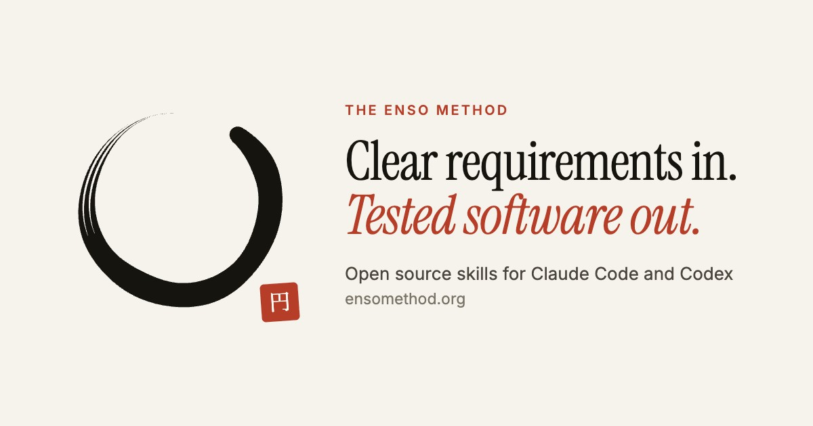
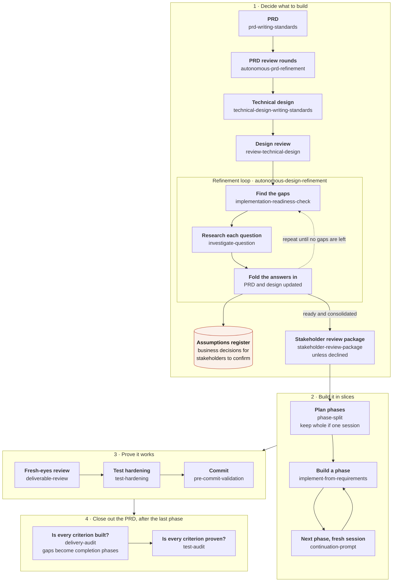

<p align="center">
  <a href="https://ensomethod.org"></a>
</p>

<p align="center">
  <a href="https://ensomethod.org"><b>ensomethod.org</b></a> ·
  <a href="#get-started">Get started</a> ·
  <a href="docs/how-the-enso-method-works.md">How it works</a> ·
  <a href="docs/enso-method-setup-guide.md">Setup guide</a>
</p>

# The Enso Method

**Clear requirements in. Tested software out.**

The Enso Method is a way of building production software with AI coding agents, delivered
as free, open source agent skills for Claude Code and Codex. You describe the outcome you
want in plain language. The method turns it into a PRD (product requirements document) and
a technical design, which agents review and fix, ready for your review before the build.
Then the agents build it in phases while your attention goes elsewhere, checking every
acceptance criterion with a test that would fail if the behavior were wrong.

Technical questions are researched against the real code, data and APIs. Open business
decisions are written down as assumptions, with a proposed answer, evidence and a confidence
level. Stakeholders confirm or correct them on their own schedule while the build continues.
Their answers go back into the requirements, which stay the source of truth for future
changes.

It is built for when **the person who decides isn't the one at the keyboard**: a client,
a business owner, a product owner. They get proposals and requirements they can actually
read. Solo developers benefit too: the decisions stay written down for the next change
and the next agent session.

## Why

Whatever you don't tell the AI, it guesses. "Add refunds to checkout" leaves the real
questions open — partial refunds? store credit? what if the payment provider is down? — and
the agent answers each one itself, without telling you. Then come the minute-by-minute
corrections, and a month later nobody can say what the code was supposed to do.

The fix isn't a better prompt. It's doing the thinking before the build:

- **Requirements lead the build.** Work starts from a PRD and a technical design, and a
  meaningful change amends them, or names what it replaces, before it is built.
- **Review before the build.** Agents review and fix the PRD and the technical design first,
  so your own read goes on the decisions, not the defects. That is where your judgment goes
  in; after that, the build runs without you.
- **Assumptions are green lights.** A business question is researched, answered with a
  proposal and a confidence level, and the build continues. Stakeholders confirm or correct
  it later.
- **Research, don't ask.** Technical questions are answered against the real code, data and
  APIs, not put to you.
- **Every phase ships.** Large work is cut into thin slices, each sized to one AI session.
- **Finished means proven.** Each acceptance criterion is checked by a test that would fail
  if the behavior were wrong, against real systems wherever they exist.

## How it works

Agents review and refine the requirements and design, researching open questions before
the build. Business proposals are gathered into a review package stakeholders can read
and respond to on their own schedule.

Large builds are divided into shippable pieces, with each session carrying forward the
same requirements and decisions. Agents build, review and test each piece, then check the
finished software against the whole PRD. The documents stay current, so future changes
start from what was intended.



Everything for one piece of work lives in one directory, and the documents stay in the repo
after the build, so the next change starts from what was decided:

```
docs/prds/customer-returns/
  customer-returns-prd.md
  technical-design.md
  assumptions.md               # business decisions proposed, awaiting confirmation
  phase-1-return-intake.md     # closed
  phase-2-refund-routing.md    # split into 2a and 2b
  phase-2a-card-refunds.md     # closed
  phase-2b-store-credit.md     # implementing
  phase-3-returns-dashboard.md # planned
```

It works on existing systems as well as new ones: the PRD covers the change, and the
technical design describes only the difference. [How it works](docs/how-the-enso-method-works.md)
has the confidence rules and the session discipline; [ensomethod.org](https://ensomethod.org)
has the full walkthrough and an example assumption.

## Get started

Install the skills in your agent:

```bash
# Claude Code
claude plugin marketplace add EnsoDynamics/enso-method
claude plugin install enso-method@enso-method

# Codex
codex plugin marketplace add EnsoDynamics/enso-method
codex plugin add enso-method@enso-method

# Other agents (Cursor, GitHub Copilot, Gemini CLI and more), with the skills CLI
npx skills add EnsoDynamics/enso-method -g
```

To update later (or, in Claude Code, turn on auto-update for `enso-method` under `/plugin` →
Marketplaces):

```bash
# Claude Code, then restart it
claude plugin marketplace update enso-method
claude plugin update enso-method@enso-method

# Codex
codex plugin marketplace upgrade enso-method

# Other agents
npx skills update -g
```

If Claude Code says `Marketplace 'enso-method' not found`, the plugin isn't installed on that
machine yet: run the install commands above. If you installed with the skills CLI before the
plugin existed, [remove those copies first](docs/enso-method-setup-guide.md#switch-from-the-skills-cli-to-the-plugin),
or every skill loads twice.

In Claude Code and Codex the skills install as a plugin, which names each one
`enso-method:<skill>` so none can clash with a same-named skill from somewhere else. New to
plugins? See how they work in [Claude Code](https://code.claude.com/docs/en/plugins/install)
and [Codex](https://learn.chatgpt.com/docs/plugins). To work from a clone of the repo, see the
[setup guide](docs/enso-method-setup-guide.md#install-and-update). Then, in your
agent (in Codex, pick skills from the `$` menu or type the full name, such as
`$enso-method:prd-writing-standards`):

1. **Write the PRD.** Run `/prd-writing-standards` and describe what you want in your own
   words. Talk it through; the messy version is better than a tidy instruction. Then run
   `/autonomous-prd-refinement`, which reviews and fixes it in rounds, ready for your review.
2. **Design and refine.** Run `/technical-design-writing-standards`. It drafts the design and
   has `review-technical-design` check and fix it, with a list of the sections worth your
   reading. Then run `/autonomous-design-refinement` to close the gaps. When requirements
   are ready and consolidation is complete, it prepares the stakeholder review package
   automatically unless you decline it; sharing and stakeholder feedback remain optional.
3. **Plan the phases.** Run `/phase-split`. It sizes the work, writes phase documents when
   needed, and hands off without building. Work that fits one session stays whole.
4. **Build.** Run `/implement-from-requirements` on the first planned phase, or the unsplit
   PRD. It builds, reviews and tests the work, retaining its sizing check as a safeguard.
   Each phase ends with the prompt for the next one's fresh session.
5. **Close it out.** When the last phase closes, its prompt starts `/delivery-audit`, which
   checks every acceptance criterion was built and adds completion phases for any gaps. Build
   those and repeat the delivery audit until clean; then `/test-audit` checks the tests prove
   every criterion and fills the gaps. Implementation fixes return through delivery audit.

Before your first real project, plug in your team's engineering standards and add two
recommended lines to your global instructions: see the [setup guide](docs/enso-method-setup-guide.md).

## The skills

Skills load on demand by name and description, so you rarely invoke one directly. Each
directory under `skills/` with a `SKILL.md` is one skill, in the open
[Agent Skills](https://agentskills.io) format.

**Start here**
- `using-the-enso-method` — the map: which skill runs at each stage, in what order, and where you review. Ask your agent to "use the Enso Method" and it loads this

**Requirements and design**
- `initiative-breakdown` — cut an initiative, an idea too big for one PRD, into right-sized planned PRDs that each reach production
- `prd-writing-standards` — write a PRD, and where the documents live
- `technical-design-writing-standards` — write or check a technical design
- `review-technical-design` — a senior review of the drafted design that checks it against the real code and your house standards, fixes what it finds, and lists the sections worth your own reading
- `assumptions-document-writing`, `assumptions-document-feedback` — declare business assumptions and fold in stakeholder answers
- `stakeholder-review-package` — create a single HTML review package with business highlights, every open assumption, contextual mockups and downloadable feedback

**Refinement**
- `autonomous-prd-refinement` — review-and-fix rounds on a drafted PRD, its assumptions and mockups, until no Medium or High finding is left
- `autonomous-design-refinement` — multi-pass refinement of the PRD, design and assumptions until they are ready to build
- `implementation-readiness-check` — a human checkpoint before implementation: surfaces every open question for you to confirm
- `investigate-question` — take one question to an answer with a confidence level

**Implementation**
- `implementation-lifecycle` — the umbrella: the assumptions philosophy, confidence thresholds and the No Loose Ends session discipline. Reload it to get a drifting session back on track
- `implement-from-requirements` — the default build from PRD and technical design
- `implement-from-discovery` — implement a fix found mid-work or raised in a bug report
- `phase-split` — size the work before implementation; split it into session-sized, shippable phases only when needed
- `continuation-prompt` — the copy-paste prompt that starts the next chat

**Quality and principles**
- `deliverable-review`, `test-hardening`, `refactor-pass` — the post-build quality chain
- `delivery-audit` — once every phase of a PRD is closed: check each acceptance criterion is actually built, and add marked completion phases for the gaps
- `test-audit` — once nothing is left to build (or on any finished phase): grade every acceptance criterion's test evidence, then fill the gaps, missing first
- `pre-commit-validation` — commit-boundary checks for a checkout several sessions share
- `engineering-principles` — the principles the method depends on: no silent fallbacks, the testing evidence standard, production data, judgment calls
- `wall-clock-awareness` — cut waiting time in tests, builds and CI

## Data handling

See the [plugin privacy policy](docs/enso-method-plugin-privacy-policy.md) for
project data, external providers, retention and support contacts.

The plugin contains instructions, documentation and two optional Python hooks.
It has no MCP servers or automatically enabled hooks, and includes no telemetry.
The optional hooks work locally: one reads prompt and transcript information to
set a session title, and the other reads tool-event metadata and writes a
temporary marker to avoid repeating an assumptions-document reminder. Neither
makes network calls. EnsoDynamics runs no service that receives project data
from the plugin.

Following the skills can involve reading project files, querying databases and
APIs, and writing requirements, assumptions and code in your workspace. Depending
on your project, those records may contain personal data. The skills can also
direct your coding agent to use external services for research, testing and
delivery, including GitHub when pushing work. Those operations use
your agent's tools, permissions and configured services. Their data handling and
retention depend on the agent and services you use.

Report sensitive security concerns through the
[security reporting channel](SECURITY.md).

## Who's behind it

The Enso Method is created and maintained by Doug Kerwin, author of *The Enterprise Vibe
Coding Playbook*, at [EnsoDynamics](https://ensodynamics.com). Every rule in it exists
because a real project needed it, and it is refined daily on production systems. If your
team wants help adopting it, that is what EnsoDynamics does.

## License and contributions

The skills are free to use, change and redistribute under the [MIT License](LICENSE),
including at work and in commercial products. The license covers the text and code, not the
name: please don't present a modified fork as The Enso Method.

Issues are welcome and forks are encouraged, but pull requests are generally not accepted.
See [CONTRIBUTING.md](CONTRIBUTING.md) for why.

---

<p align="center"><i>An ensō is a circle drawn in a single brushstroke. It is finished when the circle closes.<br/>So is every session: no loose ends.</i></p>
